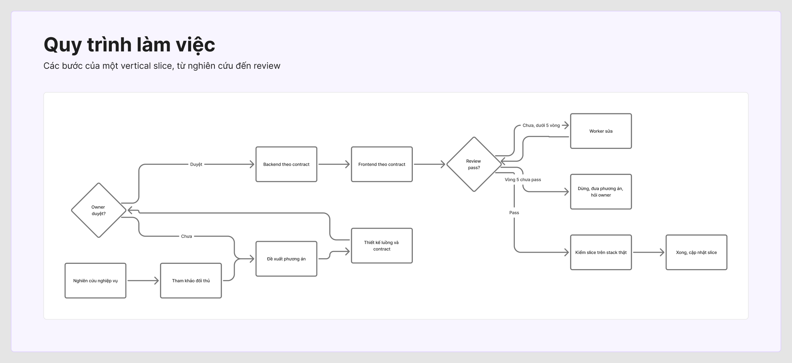

# Agent orchestra

Template điều phối nhiều coding agent (Claude Code) cho một workspace gồm
nhiều repository, thường là một backend và một frontend. Mỗi repository có
harness riêng (cài từ [harness-template](https://github.com/lckien2912/harness-template)):
`AGENTS.md`, `init.sh`, `.harness/`, hook guard, `feature_list.json`.
Orchestra là lớp nằm ở thư mục cha, chứa các repository đó:

- **Supervisor** (session chính) chấm độ phức tạp của task, chọn agent và
  model, viết brief, đọc diff thật, chạy vòng QA và báo cáo. Supervisor không
  tự viết code trong repo.
- **Agent chuyên trách**: `analyst`, `researcher`, `architect`,
  `backend-worker`, `frontend-worker`, `reviewer`, `debugger`.
- **Vertical slice**: mỗi tính năng người dùng đi một mạch qua cả hai repo,
  theo một contract chung, và owner duyệt trước khi code.
- **Hook dispatcher**: lệnh chạy từ thư mục cha vẫn bị guard của đúng repo
  kiểm tra. Rule chỉ nằm trong `<repo>/.harness/`.
- **Nhật ký quyết định của owner**: ý nào owner nhắc lại sẽ thành rule của
  harness khi `/cleanup-sprint`.

## Quy trình một slice



1. `analyst` nghiên cứu nghiệp vụ, tham khảo đối thủ, đề xuất phương án, thiết
   kế luồng và contract nháp, rồi ghi tất cả vào `slices/<slug>.md`.
2. **Owner duyệt.** Chưa duyệt thì sửa đề xuất hoặc luồng rồi trình lại.
3. Backend làm theo contract, sau đó frontend làm theo contract.
4. Review từng feature. Chưa pass thì worker sửa, tối đa 5 vòng. Vòng 5 vẫn
   chưa pass thì dừng: Supervisor đưa owner các phát hiện còn mở và 2–3
   phương án, rồi chờ owner quyết.
5. Pass thì kiểm cả slice trên stack thật (e2e với API thật), xong cập nhật
   file slice.

## Cấu trúc

```
<workspace>/
  CLAUDE.md                     # luật workspace, bảng agent, lệnh
  owner-decisions.md            # nhật ký quyết định/yêu cầu của owner
  slices/TEMPLATE.md            # khung file slice (Business → Result)
  docs/orchestra-diagram.png
  .claude/
    orchestra.json              # danh sách repo: key → thư mục, worker; bảng sơ đồ (tuỳ chọn)
    settings.json               # permission + hook gọi dispatch.sh
    hooks/dispatch.sh           # chuyển mỗi tool call tới hook của repo nó chạm vào
    agents/                     # supervisor, analyst, researcher, architect,
                                # backend-worker, frontend-worker, reviewer, debugger
    commands/                   # /slice, /prepare-phase, /feature, /cleanup-sprint
    skills/task-routing/        # playbook của Supervisor
    scripts/
      feature.mjs               # đọc một feature trong feature_list.json (không đọc cả file)
      gate.sh                   # chạy init.sh của repo, chỉ in tóm tắt + log tail
      usage-report.mjs          # token thật của từng lần giao việc, theo agent và model
  tests/run.sh                  # self-test cho dispatch.sh, feature.mjs, gate.sh
  backend/                      # repo riêng (git riêng, có harness), bị .gitignore
  frontend/                     # repo riêng (git riêng, có harness), bị .gitignore
```

## Cài đặt

1. Clone template này làm thư mục workspace, rồi clone (hoặc tạo) các repo vào
   trong nó. Mỗi repo cài harness từ `harness-template`.
2. Sửa `.claude/orchestra.json`: key (`api`, `ui`), thư mục và worker của
   từng repo. Thêm các thư mục đó vào `.gitignore`.
3. Điền `CLAUDE.md`: tên dự án, bảng repo, tài liệu thiết kế, thị trường để
   `analyst` tham khảo đối thủ.
4. Điền mục **Project knowledge** trong `backend-worker.md` và
   `frontend-worker.md` khi dự án lớn dần. Thứ gì đã ổn định thì chuyển sang
   `AGENTS.md` của repo.
5. (Tuỳ chọn) Link craft skill của repo vào workspace rồi bật trong
   frontmatter của worker:
   `ln -s ../../backend/.claude/skills/backend-engineering .claude/skills/`
6. (Tuỳ chọn) Muốn Supervisor vẽ sơ đồ luồng thì đặt `diagrams.fileKey` (một
   bảng FigJam) trong `orchestra.json`.
7. Mở Claude Code ở thư mục workspace. Session chính là Supervisor, hoặc chạy
   `claude --agent supervisor`.

## Lệnh

| Lệnh                                 | Việc                                                         |
| ------------------------------------ | ------------------------------------------------------------ |
| `/slice <slug> <mục tiêu>`           | Chạy một vertical slice từ nghiên cứu đến review             |
| `/prepare-phase <repo-key\|all> <N>` | Lập kế hoạch phase N bằng lệnh của từng repo; backend trước  |
| `/feature <repo-key> <feat-id>`      | Chấm điểm, giao cho worker của repo, chạy vòng QA            |
| `/cleanup-sprint <repo-key> [next]`  | Đóng milestone; đưa các quyết định owner lặp lại vào harness |

## Định tuyến (tóm tắt `task-routing`)

Mỗi task được chấm 0–2 trên 8 tiêu chí: kỹ thuật, số module, số file, phụ
thuộc, kiến trúc, bảo mật, nghiệp vụ, rủi ro. Tổng điểm cho ra mức:
**LOW 0–4, MEDIUM 5–9, HIGH 10+**. Có tiêu chí bảo mật = 2, kiến trúc = 2,
hoặc đụng Protected Decision thì luôn là HIGH.

| Bước       | LOW                 | MEDIUM          | HIGH                                  |
| ---------- | ------------------- | --------------- | ------------------------------------- |
| Nghiên cứu | bỏ qua / haiku      | haiku           | haiku hoặc sonnet                     |
| Kế hoạch   | —                   | —               | architect/opus → **owner duyệt**      |
| Làm        | worker/haiku        | worker/sonnet   | worker/sonnet theo từng bước đã duyệt |
| Review     | Supervisor đọc diff | reviewer/sonnet | reviewer/opus khi có yếu tố bảo mật   |

Thang leo khi kẹt là haiku → sonnet → opus, tối đa hai bậc mỗi task. Mỗi lần
giao việc giới hạn khoảng 50 tool call, chạy tối đa 3 worker song song, và
không worker nào được sửa file của worker khác. Muốn đo token thật thì chạy
`node .claude/scripts/usage-report.mjs --since <ngày>`.

## Kiểm thử

```bash
bash tests/run.sh
```

Script dựng một workspace tạm gồm hai repo giả (hook và gate giả), rồi kiểm:
`dispatch.sh` chọn đúng repo theo cwd, theo tên trong lệnh và theo đường dẫn
file, block thắng ask, payload hỏng thì cho qua; `feature.mjs` đọc theo key,
thư mục và dependency; `gate.sh` chạy baseline, integration và in log khi lỗi.
