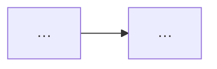

# Slice: <feature name> (`<slug>`)

Goal (owner's words): …
Status: research | waiting for owner | in progress | review | stopped (waiting for owner) | done
Features: <backend-repo> feat-… · <frontend-repo> feat-…

## 1. Business

- Users and the job they need done:
- Business rules, states:
- What exists (`path:line`):
- Questions for the owner:

## 2. Competitors

| Product | How they do it | Source (URL, date read) |
| ------- | -------------- | ----------------------- |

Takeaways:

## 3. Proposal

| Option | Scope / UX | Backend / frontend effort | Risk |
| ------ | ---------- | ------------------------- | ---- |

Recommended: … · Out of scope: … · Protected Decisions for the owner: …

## 4. Flow

Diagram (Mermaid below; board link if one is configured): <link>

Screens and states per role (empty, loading, error, success):

| Step | User does | API | Result | Feedback (skeleton / pending / toast / field error) |
| ---- | --------- | --- | ------ | --------------------------------------------------- |

## 5. Shared contract (fixed before code, approved with §3–4)

| Route | Auth / scope | Request | Response | Errors (`code` → `field:<name>` or `toast`) |
| ----- | ------------ | ------- | -------- | ------------------------------------------- |

Changing the contract after approval: edit it here and in the backend feature
first, then the frontend mapper.

## 6. Delivery

| Step | Repo / feature | Worker / model | Branch | Status |
| ---- | -------------- | -------------- | ------ | ------ |

## 7. Review log (at most 5 rounds per feature; round 5 without pass → stop, ask the owner)

| Round | Feature | Reviewer / model | Verdict | Main findings |
| ----- | ------- | ---------------- | ------- | ------------- |

## 8. Result

PRs, evidence (gates, e2e on the stack, screenshots), open items.

Closing the slice: both repos' `progress.md` updated · frontend client
generated from the API spec (not hand-typed) · worktrees, branches and dev
databases cleaned up or listed for the owner.
